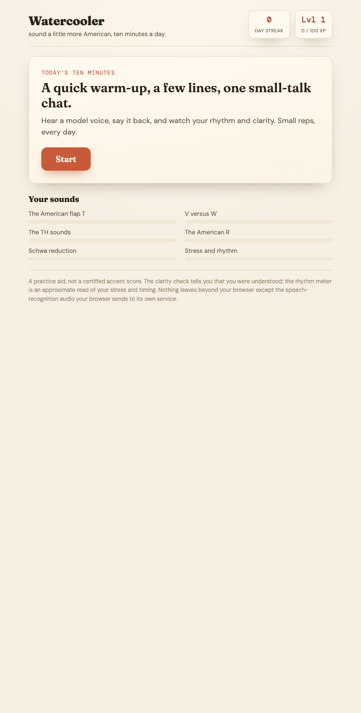

# Watercooler

A small daily game for sounding a little more American and getting comfortable with workplace small talk. You play about ten minutes a day: a quick sound warm-up, a few lines to shadow, and one small-talk chat. It runs fully in the browser, free, with no accounts and no keys.



## How a session works

1. **Sound of the day.** One target sound (the flap T in "water", V versus W, the TH sounds, the American R, schwa reduction, stress and rhythm). You get a quick how-to, then hear each word and say it back. The browser checks you were understood clearly.
2. **Shadow the line.** A few real workplace lines. Hear the US voice, say it the same way, and get a rhythm meter plus a playback of yourself.
3. **Small talk.** A role-play prompt ("Morning, how was your weekend?"). You reply out loud, get light feedback on whether it sounded natural, and hear a model reply to copy.

You keep a daily streak, earn XP and levels, and fill a mastery bar for each sound. Everything is saved in your browser.

## The honest part

Free browser speech recognition is built to understand accents, so it can tell you that you were **clear and understood**, but it cannot grade **how American** you sound, and it gives no per-sound score. So this trains the way real courses do: hear a model, say it back, compare.

The one real accent signal it can give for free is **rhythm**. American English is stress-timed, meaning stressed syllables are long and loud and the rest get crushed short and quiet. The rhythm meter measures that unevenness in your recording (a variability metric called nPVI) and scores it. It is an approximate read, not a certified grade, and the app says so.

## Built with

Plain browser APIs, no backend:
- **SpeechSynthesis** for the US model voice (shadowing).
- **SpeechRecognition** for the clarity check (Chrome, Edge, Safari; not Firefox).
- **Web Audio + MediaRecorder** to record you and compute the rhythm score.
- **React + Vite**, deployed as a static site.

## Run it

```
npm install
npm run dev        # http://localhost:5173
```

Use Chrome, Edge, or Safari, and allow the microphone when asked.

## Tests

The math runs without a browser, so it is unit tested:

```
npm test
```

It checks the rhythm score (uneven, stress-timed speech scores higher than even speech), the streak, XP, mastery, and badge logic, and the small-talk phrase matching.

## Notes

- Needs a mic and a Chromium-based browser or Safari. It warns and degrades where a feature is missing.
- TTS voice quality varies by device; the app picks the best US voice it finds.
- The speech-recognition step sends audio to the browser's own speech service; nothing else leaves your machine.

## License

MIT. See [LICENSE](LICENSE).
